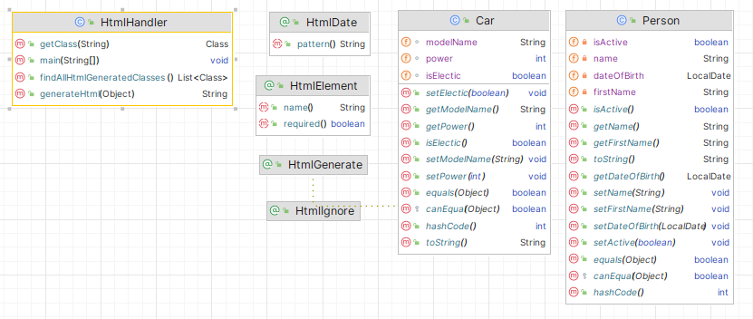

## Aufgabenstellung PLF 301

**Einführung:**

In der Softwareentwicklung ist es oft notwendig, Daten in einer 
ansprechenden und organisierten Weise zu präsentieren. 
HTML bieten eine hervorragende Möglichkeit, dies zu 
erreichen. In dieser Aufgabe erarbeiten Sie, wie Sie HTML aus 
Java-Objekten mithilfe von Annotationen generieren können.

**Aufgabenbeschreibung:**

1. **Erstellen Sie die folgende Annotationen:**
    * [8P] `HtmlDate`, `HtmlElement`, `HtmlIgnore`, `HtmlShow`
    * Die Annotation sind um `value` z.B. `name` oder ähnliches im Bedarfsfall zu erweitern (siehe Klassendiagramm).

1. **Erstellen Sie die Klasse `HtmlHandler`:**
    * Analysieren Sie die HTML-Seite, um zu verstehen, wie die Objekte auszugeben sind.
    * [2P] Vervollständigen Sie die Klassen `Person` und `Car` mit den entsprechenden Annotation. Achten Sie darauf, dass die Klasseattribute nicht verändert werden dürfen.
    * [2P] Erstellen Sie eine Java-Klasse namens `HtmlHandler.java`.
    * [10P] Implementieren Sie eine Methode `generateHtml(Object o)`, die ein Objekt als Parameter erhält und eine HTML-Zeichenfolge zurückgibt (siehe unten), welche die Details des Objekts darstellt.
    * [8P] Implementieren Sie die Methode `findAllHtmlGeneratedClasses`, welche eine Liste von `Class` Objekten zurückgibt. In der Liste sind nur Klassen, welche mittels `@HtmlGenerate` annotiert sind. 
    * Verwenden Sie Reflections, um auf die Attribute des Objekts zuzugreifen und die HTML-Elemente dynamisch zu generieren.
    * [1P] Rufen Sie die Methode `HtmlHandler.generateHtml` auf und übergeben Sie die `Person`- und `Car`-Objekte als Parameter.

1. **Testen Sie ihr Software**
    * [1P] Schreiben Sie Testfälle für die Annotationen.

1. **Hinweise**
    * Es sind **keine** `html` zu erstellen.
    * Die Methode sind vorgegeben und dürfen nicht verändert werden.
    * Die Klassenname der vorgegebenen Klassen dürfen nicht geändert werden.
    * Fühlen Sie sich frei, wenn sie weitere Methoden schreiben müssen.
    * Achten Sie auf unseren vereinbarten `clean-code` Standard.


1. **Beispiel für die Ausgabe der `.html` Seite**
```text
<!DOCTYPE html>
<html>
<body>
  <h1>Car</h1>
  <p>Modellname: Porsche</p>
  <p>Leistung: 345</p>
</body>
</html>
```

```text
<!DOCTYPE html>
<html>
<body>
  <h1>Person</h1>
  <p>Nachname: Schreiber</p>
  <p>firstName: Florian</p>
  <p>Geburtsdatum: 03.12.1988</p>
</body>
</html>
```

**Klassendiagramme**

